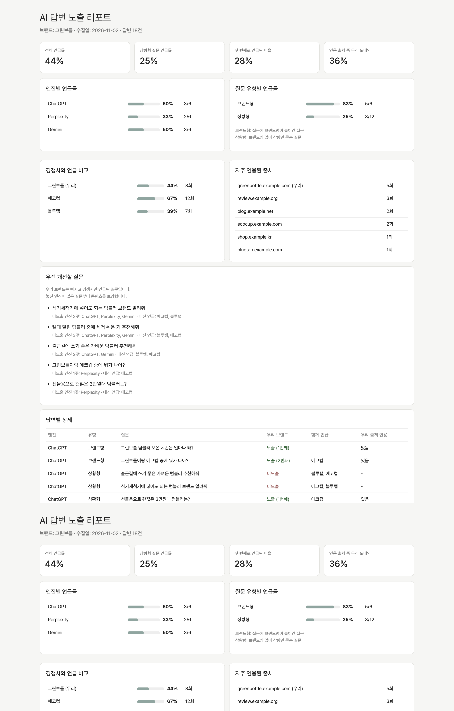
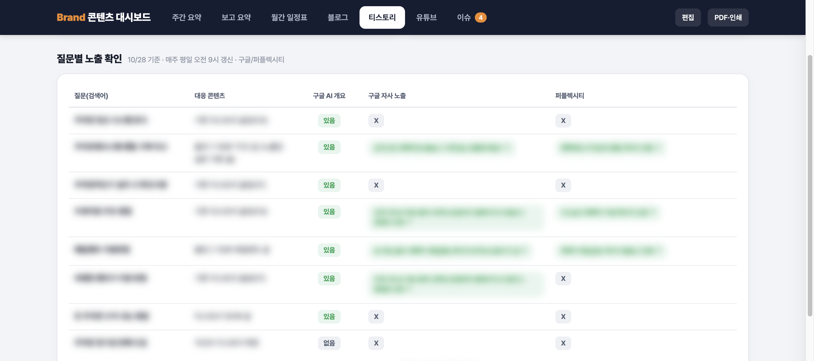

# ai-answer-visibility-check

ChatGPT, Gemini, Perplexity 같은 AI 답변에 우리 브랜드가 얼마나, 어떤 순서로, 어떤 출처와 함께 나오는지 점검하는 도구입니다.

## 제작 배경

매주 AI 검색 노출을 보고하면서 ChatGPT나 퍼플렉시티에 직접 물어보고 캡처하는 방식에 한계를 느꼈습니다.  
같은 질문도 물어볼 때마다 답이 달라서 지난주보다 나아졌다고 말할 근거가 약했습니다.  
그래서 질문 목록을 고정해 두고 같은 기준으로 반복해서 기록하기 시작했고 그 방식을 도구로 정리했습니다.

## 주요 기능

| 지표 | 의미 |
|---|---|
| 언급률 | 답변에 우리 브랜드가 나온 비율 (엔진별, 질문 유형별) |
| 첫 언급 순서 | 여러 브랜드가 함께 나올 때 우리 브랜드가 몇 번째로 나왔는지 |
| 경쟁사 언급 비교 | 같은 질문들에서 경쟁 브랜드가 나온 비율 |
| 인용 출처 | 답변이 근거로 단 링크 중 우리 도메인 비율, 자주 인용된 도메인 |
| 우선 개선할 질문 | 우리 브랜드는 빠지고 경쟁사만 나온 질문 (놓친 엔진이 많은 순) |

질문은 두 유형으로 나눠 봅니다.

- **브랜드형**: 질문에 브랜드명이 들어간 질문 (예: "그린보틀 텀블러 보온 시간은?")
- **상황형**: 브랜드명 없이 상황만 묻는 질문 (예: "출근길에 쓰기 좋은 텀블러 추천해줘")

실제 고객은 상황형으로 묻는 경우가 많아서 상황형 언급률을 핵심 지표로 봅니다.

## 리포트 예시



`sample/` 폴더의 가상 브랜드(그린보틀) 데이터로 만든 예시입니다.

## 실무 적용

이 저장소는 실무에서 운영 중인 콘텐츠 성과 측정 시스템 중, 공개할 수 있는 부분을 일반화한 것입니다.

실무 버전은 AI 답변 노출 점검과 함께 다음을 하나의 대시보드로 묶어 운영합니다.

- 검색 키워드 순위 점검
- 블로그·티스토리·유튜브 채널별 성과 수집
- GA4 UTM 기반 CTA 클릭 추적
- 주간 발행 계획, 이슈 정리

성과 데이터는 매일 오전 9시와 오후 5시에 자동으로 갱신됩니다.  
회사 데이터 보호를 위해 이 저장소의 브랜드와 수치는 모두 가상 예시로 바꿨습니다.



실제 운영 중인 대시보드의 '질문별 노출 확인' 화면입니다.  
질문마다 구글 AI 개요, 구글 검색, 퍼플렉시티에서 자사 콘텐츠가 노출·인용됐는지 기록합니다.  
질문과 콘텐츠명, 인용 출처는 가렸습니다.

## 사용법

파이썬 3만 있으면 됩니다.  
추가 설치는 필요 없습니다.

1. `config.json`: 우리 브랜드, 다른 표기, 공식 도메인, 경쟁사 입력
2. `questions.csv`: 점검할 질문과 유형 입력
3. 답변 수집
   - 직접 수집: 각 AI 서비스의 답변과 인용 링크를 `answers.csv`에 붙여 넣기
   - 자동 수집(선택): OpenAI API 키로 `collect.py` 실행 (키는 환경 변수로만 입력)
4. 리포트 생성

```bash
python3 analyze.py                         # 예시 데이터로 실행
python3 analyze.py --questions my_questions.csv --answers my_answers.csv --config my_config.json
# (선택) export OPENAI_API_KEY=... 후
python3 collect.py --questions my_questions.csv --answers my_answers.csv
```

## 운영 원칙

- 한 번의 결과는 그 시점의 관측값으로만 판단 (AI 답변은 실행마다 달라짐)
- 같은 질문을 주기적으로 다시 수집해 추이로 판단
- 수집 조건(로그인 여부, 지역, 이전 대화) 함께 기록

## 한계

- 브랜드 언급은 이름·다른 표기의 포함 여부로 판단
- 긍정·부정 맥락은 아직 구분하지 않음
- `collect.py`는 OpenAI API 응답 형식 기준으로 작성 (예시 저장소에서는 실제 키로 실행하지 않음)

## License

MIT
